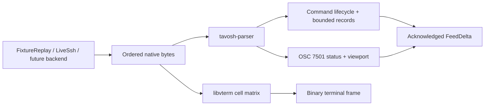

# Tavosh Core architecture

The public Rust workspace owns versioned protocol framing, stream parsing,
synthetic terminal fixtures and the optional host-side companion. The app
depends on the core and owns SSH transport, libvterm and the mobile UI.

M1 adds a deterministic [terminal trace format](protocol.md#terminal-replay-trace-v1).
Its relative delays and raw payloads drive the app's native terminal worker
in timed replay or as fast as the worker can consume them. The
[fixture generator](../fixtures/generate_m1.py) produces VT100, btop and nvim
regression streams. Rust tests cover fragmented reads, malformed records and
the end of the stream. The app tests viewport behavior by replaying the same
fixtures through libvterm.

The app's display frame ABI and Skia batching strategy live in its architecture
guide. The core trace format carries terminal bytes and timing. On mobile,
those bytes stay in the native worker.

See [parser design](parser.md), [daemon design](daemon.md) and the
[roadmap](roadmap.md) for the remaining public components.

## M2 connection schema

`tavosh-proto::connection::v1` defines SSH session configuration, connection
states, disconnect reasons, and host-key fingerprints and decisions. Credential
fields reference app-managed entries. The schema carries no private key bytes.
The app selects the backend, owns the trust store, and drives its SSH transport
and tmux attachment. The future daemon can reuse the shared schema where
appropriate. See the [schema contract](protocol.md#ssh-connection-schemas).

## M3 adaptive command stream

`feed` schema v1 adds `CommandBlock`, `BlockState`, normalized `TreeNode`, typed
text diffs, `StructuredOutput`, `ViewportMode` and `ProgramStatusEvent`.
`StreamParser` supplies OSC 133 boundaries and controlled-clock heuristic
fallback, OSC 7501 status, alternate-screen transitions and size-bounded
classification. See [parser rules and memory bounds](parser.md).

Both app backends feed the same native pipeline:

Core has no mobile, SSH policy or credentials dependency. The app owns worker
scheduling, bounded polling, the C ABI, Nitro and both rendering surfaces.
Snapshots expose retained records. `FeedDelta` contains an authoritative
ordered `block_ids` list, new/changed `blocks`, `reset`, generation, viewport
and latest status. Consumers discard their cache on reset, apply blocks by ID,
and retain exactly the listed IDs. A producer may coalesce pending updates
only against the last consumed baseline, preserving unacknowledged completions.
